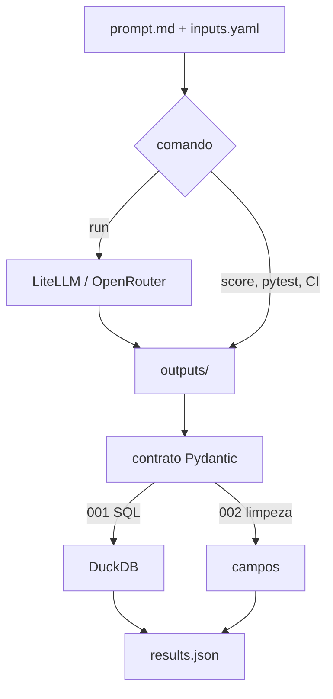

# Prompt Lab

Pipeline de avaliação para LLM em tarefas de dados: prompts versionados, uma variável por vez, métrica determinística. Cobre **experimentação com LLMs**, não automação em produção nem dashboard interno.

Não é um chat e não é treino de modelo. O recorte é **avaliar e manter** o pipeline.

Pesquisa que orientou o layout: [docs/pesquisa-portfolio.md](docs/pesquisa-portfolio.md).

## Como funciona

`run` chama o modelo e grava `outputs/`. `score`, `pytest` e o CI só relêem o que já está no Git.



## Exemplo de prompt

A v2 do 001 (a que sobe o `pass_rate`). System e user pedem o mesmo contrato; o modelo não vê os `INSERT`.

System (`experiments/001-sql-generation/v2/system.md`):

```
Você escreve SQL DuckDB para a pergunta do usuário. Use somente as tabelas e colunas do esquema. A resposta inteira é um objeto JSON com a chave sql.
```

User (`experiments/001-sql-generation/v2/prompt.md`):

```
Esquema:

{{schema}}

Pergunta: {{question}}

Responda com um JSON neste formato, sem texto em volta:

{"sql": "SELECT ..."}
```

A v1 tira o JSON e pede “só a consulta” — é a única mudança. A v3 só acrescenta dois few-shots; o `pass_rate` não sobe. A 002 segue o mesmo corte com `{"rows": [...]}`.

## 001 — Geração de SQL

Modelo pinado: `openrouter/nvidia/nemotron-3-ultra-550b-a55b:free` (OpenRouter, 2026-10-28). Custo USD 0. Uma variável por vez.

| prompt | json_ok | rows_match | pass_rate |
|---|---|---|---|
| v1 — “só SQL” | 0/6 | 5/6 | **0.00** |
| v2 — `{"sql": "..."}` | 6/6 | 5/6 | **0.83** |
| v3 — v2 + 2 few-shots | 5/6 | 5/6 | **0.83** |

O contrato JSON tira o `pass_rate` de 0 para 0.83. Few-shot em cima **não** sobe. [experiments/001-sql-generation/README.md](experiments/001-sql-generation/README.md).

## 002 — Limpeza de dados

Mesmo modelo, mesma data. Só muda o contrato (texto vs `{"rows": [...]}`). Sem few-shot.

| prompt | json_ok | field_accuracy | pass_rate |
|---|---|---|---|
| v1 — “linhas limpas” | 0/6 | 0.00 | **0.00** |
| v2 — `{"rows": [...]}` | 6/6 | 1.00 | **1.00** |

A v1 acerta o conteúdo em CSV/NDJSON e falha o envelope. A v2 passa os 6 casos, inclusive `cancelado` intacto e `notes` dropado. [experiments/002-data-cleaning/README.md](experiments/002-data-cleaning/README.md).

## Requisitos

- [uv](https://docs.astral.sh/uv/)
- Python 3.11 ou mais novo. O `.python-version` fixa 3.12.

## Comandos

```powershell
uv sync
uv run pytest
uv run python -m prompt_lab score experiments/001-sql-generation
uv run python -m prompt_lab score experiments/002-data-cleaning
uv run python -m prompt_lab run experiments/002-data-cleaning
uv run streamlit run app/streamlit_app.py
```

`pytest` e `score` são offline. `run` chama o OpenRouter e grava `outputs/` das versões pedidas. O Git já traz as saídas; clonar não precisa de chave.

## Segredos

Copie `.env.example` para `.env` só para o `run`. O `.env` fica fora do Git.

```
OPENROUTER_API_KEY=
```

Modelo default: `openrouter/nvidia/nemotron-3-ultra-550b-a55b:free`. Não use o router `openrouter/free`.

## O que não está aqui

- Treino, Hugging Face, Kaggle.
- promptfoo, juiz LLM, CoT, change-point, federação.
- Repeats n>1 (consistência). O runner recusa `--repeats` diferente de 1 de propósito.
